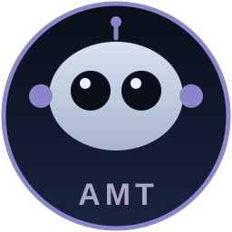

# AMT Chat



> **ENGLISH:** [README_EN.md](README_EN.md)
>
> Локальный (desktop) ИИ-ассистент: чат с любой OpenAI-совместимой или локальной
моделью, генерация медиа и файлов, система **агентов / скиллов / личностей**,
**оркестратор** качества диалога, лонг-терм **память**, безопасные
**инструменты** (файлы/команды), встроенный **медиа-плеер** и расширяемая
**система плагинов**. Работает полностью локально: бэкенд — FastAPI (Python),
фронтенд — vanilla JS (без фреймворков), оболочка — Electron. API-ключ и все
данные хранятся только у вас.

> Это **первый официальный релиз (1.0.0)**. Полный список функций и как всё
> работает — в `README.md#возможности` и прямо в приложении:
> «Справка → Об app», «Справка → Как писать», «Справке → Апдейты» (v1.0.0).

## Возможности

- **Чат** — любая OpenAI-совместимая API или локальная модель (Base URL +
  ключ + модель). Мульти-ключи с авто-переключением при 429 (по приоритету или
  round-robin). Markdown-ответы. Вставка картинок/скриншотов/файлов (Ctrl+V) —
  содержимое попадает в контекст ИИ. Голосовой чат: STT + TTS через любой
  провайдер.
- **Агенты** — роль + системный промпт + модель/температура + набор скиллов.
  Ядро (Веб-агент, Глубокий аналитик, Без фильтров) создаётся автоматически,
  свои агенты — через UI или импортом `agents.json`/JSONL.
- **Скиллы** — переиспользуемые инструкции, подключаются к агенту или в чате
  отдельно.
- **Личности** — готовый профиль (API-ключ + модель + агенты + скиллы +
  оркестратор), создаётся в UI или импортом JSONL (по одной сессии на строку).
- **Оркестратор** — контроль контекста (сжатие истории при переполнении окна
  модели), контроль дрейфа роли, умное сохранение чата по порогу сообщений,
  мониторинг (задержка/ошибки/среднее по 100 запросам). Настраивается в
  «Настройки → Оркестратор».
- **Память** — лонг-терм факты между чатами, автоматически подставляются в
  системный промпт; лимит и очистка в «Настройки → Память».
- **Медиа-генерация** — `[[GEN:image|…]]`, `[[GEN:video|…]]`, `[[GEN:audio|…]]`,
  `[[GEN:file|…]]` — ИИ вставляет готовый элемент (картинка/видео/аудио/файл)
  прямо в сообщение; работает с ЛЮБЫМ провайдером через OpenAI-совместимые
  эндпоинты, не только OpenAI. Автодетект Agnes по base_url
  (`https://apihub.agnes-ai.com/v1`) — включаются Agnes-специфичные параметры
  (`return_base64: true` для картинок, `seconds: "5"` для видео). Файлы
  (xlsx/docx/pptx): бэкенд открывает реальный файл, ИИ видит данные, а не
  «бинарный файл».
- **Безопасные инструменты (tool-calling)** — чтение/запись файлов, создание
  папок, листинг каталогов, запуск команд — только в выбранной «рабочей папке»
  (проект). Запись/команды требуют подтверждения (auto-approve выкл по
  умолчанию), команды — только из белого списка. Всё логируется.
- **Медиа-плеер** — YouTube/Twitch embeds, прямые `.mp4`/`.m3u8`, фото, аудио —
  воспроизводятся в чате/плеере, fullscreen, фильтры (яркость/контраст/
  детализация/шум/улучшение). Сайты, блокирующие iframe (X-Frame-Options),
  открываются во встроенном frameless-браузере. `[[SCREENSHOT:url]]` — реальный
  скриншот страницы через Electron `capturePage`, не og:image.
- **Расширения** — папки в `extensions/` с `manifest.json` (+ опц. `index.js`,
  `backend.py`) — без перекомпиляции приложения. Управление: «Справка →
  Расширения» (вкл/выкл/добавить/обновить список).
- **Хранилище** — просмотр и экспорт всех данных (агенты/скиллы/ключи/темы/
  расширения/чат).
- **Логи** — дашборд событий по API/оркестратору/инструментам с фильтрами.
- **Темы** — готовые + своя (градиент), шрифт и фон, язык интерфейса (RU/EN).
- **Desktop** — Electron + встроенный Python-бэкенд (sidecar, PyInstaller),
  NSIS-инсталлятор для Windows.

##  Быстрая установка (без сборки)

**Один файл — и всё готово.** Запустите `AMT Chat Setup 1.0.1.exe` из папки
`release/` и следуйте мастеру установки. Не нужно устанавливать Python,
Node.js или другие зависимости — всё уже включено в инсталлятор.

```
release/AMT Chat Setup 1.0.1.exe
```

После установки: **Настройки → Подключение** — введите API-ключ, начните чат.
Подробности — в `release/AMT-Chat-1.0.1/README.txt`.

> Готовый ZIP-архив: `release/AMT-Chat-1.0.1.zip` (~138 МБ). Распакуйте и
> запустите `AMT Chat Setup 1.0.1.exe` — установка завершится за 2 минуты.

### Скачать из GitHub Release

Готовый ZIP-архив (exe + README.txt) лежит в релизе
[`v1.0.1`](https://github.com/clashssd/AMT/releases/tag/v1.0.1) как attachment
`AMT-Chat-1.0.1.zip` (~138 МБ).

1. Откройте страницу релиза:
   `https://github.com/clashssd/AMT/releases/tag/v1.0.1`
2. Нажмите на `AMT-Chat-1.0.1.zip` в блоке **Assets** — файл скачается.
3. Распакуйте архив → запустите `AMT-Chat-1.0.1/AMT Chat Setup 1.0.1.exe`.
4. В приложении: **Настройки → Подключение** — введите API-ключ. Готово.

> Содержимое ZIP:
> ```
> AMT-Chat-1.0.1/
> ├── AMT Chat Setup 1.0.1.exe   ← установщик (NSIS, 138 МБ)
> └── README.txt                  ← краткая инструкция (RU + EN)
> ```
> Всё необходимое (Python, Node.js, Electron, бэкенд) уже включено в
> установщик — дополнительные зависимости ставить **не нужно**.

## Как установить (для обычного пользователя, без ручных зависимостей)

**Рекомендуемый способ — одна команда.** Не нужно качать большой .exe и
не нужно вручную ставить Python/Node — просто клонируйте исходники и
запустите один скрипт, он сам поставит всё остальное и соберёт готовое
приложение:

```powershell
git clone https://github.com/clashssd/AMT.git
cd AMT
powershell -ExecutionPolicy Bypass -File scripts\bootstrap_and_build.ps1
```

Скрипт `bootstrap_and_build.ps1` сам, без вашего участия:
1. Проверит, установлены ли **Python 3.12+** и **Node.js**; чего нет —
   установит автоматически через `winget` (стандартный пакетный менеджер
   Windows 10/11, уже есть в системе; на очень старых/минималистичных
   установках без winget — поставьте их вручную, см. `docs/SETUP.md`).
2. Создаст локальное окружение `backend/.venv` и поставит Python-зависимости.
3. Поставит Node-зависимости.
4. Соберёт готовый `AMT Chat.exe` (портативный) и `AMT Chat Setup <версия>.exe`
   (NSIS-установщик) — именно этот инсталлятор можно будет запустить как
   обычное приложение Windows, как описано ниже.
5. Применит патч иконки в готовом `.exe` (обход известного бага
   electron-builder 25.1.8, который молча пропускает кастомную иконку на этой
   связке).

Результат (через ~5-10 минут):
- `release\win-unpacked\AMT Chat.exe` — портативная копия, можно запускать
  сразу, без установки.
- `release\AMT Chat Setup <версия>.exe` — классический инсталлятор; запустите
  его, и приложение установится как обычное Windows-приложение (ярлык на
  рабочем столе, пункт «Удалить» в «Параметры → Приложения»).

> Почему не «просто скачать готовый .exe из релиза»: готовый инсталлятор
> весит ~130 МБ — это превышает жёсткий лимит GitHub на один файл в обычном
> `git push` (~100 МБ), поэтому сам `.exe` в репозиторий **не коммитится**
> (см. `.gitignore`). Если у вас есть готовый `AMT Chat Setup.exe` от
> разработчика (например, переданный файлом), его можно просто запустить —
> это то же самое приложение, собранное тем же пайплайном.

### Для разработчика / CI (пересобрать с нуля без скрипта)

Если нужно собрать вручную, без `bootstrap_and_build.ps1`:

```bash
python setup.py        # создаст backend/.venv + поставит зависимости
node setup.js          # npm install
npm run build:all      # PyInstaller -> dist/, затем electron-builder -> release/
node scripts/patch_exe_icon.js   # обход бага с иконкой (см. выше)
```

Подробнее — `docs/BUILD.md`, `docs/SETUP.md`.

## Структура

```
main.js               Electron main process (frameless-окно, sidecar, IPC)
electron/             sidecar.js, ipc.js, preload.js
backend/              FastAPI-бэкенд
  main.py             точки входа API + StaticFiles-раздача фронтенда
  ai_engine/          agents.py, orchestrator.py, memory.py, media.py,
                      tools.py, web_scraper.py, keymanager.py,
                      extensions.py, filegen.py, sysinteraction.py
  agents.json         seed-ядро агентов/скиллов (создаётся при старте)
  keys.json           ваши API-ключи (пустой шаблон, не коммитится)
  settings.json       конфиг оркестратора
  changelog.json      история версий (показывается в «Справке → Апдейты»)
frontend/             HTML/JS/CSS (vanilla, без фреймворков)
  home.html           основной UI (SPA)
  js/                 main.js и вспомогательные модули
  css/style.css       стили
  assets/icon.svg     иконка приложения (источник), favicon.ico (сгенерирована)
extensions/           папки расширений (пример: extensions/example)
docs/                 EXTENSIONS.md, BUILD.md, SECURITY.md, SETUP.md
tests/                pytest (бэкенд) + node (фронтенд-модули)
```

## Быстрый старт (dev, в браузере)

Бэкенд сам раздаёт фронтенд через `StaticFiles`, поэтому достаточно:

```bash
# Python 3.12+ и Node.js установлены
python -m venv backend/.venv
backend/.venv\Scripts\pip install -r requirements.txt pyinstaller
cd backend && ..\.venv\Scripts\uvicorn main:app --port 8000
```

Откройте `http://127.0.0.1:8000`. Включите API-ключ в «Настройки →
Подключение».

> Тесты бэкенда: `backend\.venv\Scripts\python.exe -m pytest tests/`.

## Desktop (Electron)

```bash
npm install            # установит electron + electron-builder
npm start              # запустит Electron: поднимет Python-бэкенд, откроет окно
```

Electron находит `backend/.venv/Scripts/python.exe` (или используйте
`AMT_PYTHON`). Бэкенд стартует на `127.0.0.1:8000`, фронтенд грузится с этого
URL — все `fetch`-вызовы работают без изменений.

Окно — frameless: собственный тайтлбар (перетаскивание, кнопки мин/макс/закрыть)
нарисован в HTML и следует активной теме приложения; нативная серая полоса
Windows-заголовка не показывается.

## Сборка (дистрибутив)

См. `docs/BUILD.md` и `docs/SETUP.md`. Кратко:

```bash
npm run build:py       # PyInstaller: backend -> dist/amt-backend/ (sidecar-бандл)
npm run build:win      # electron-builder: NSIS-инсталлятор -> release/
# или всё разом:
npm run build:all      # node scripts/build.js all
```

Результат: `release/AMT Chat Setup <версия>.exe` (версия из `package.json`).
electron-builder копирует `dist/amt-backend/` в `extraResources` бандла,
использует `frontend/assets/favicon.ico` (сгенерирована из
`frontend/assets/icon.svg`) как иконку exe/инсталлятора.

## Расширения

См. `docs/EXTENSIONS.md` и в самом приложении: «Справка → Как писать» (полный
гайд с шаблонами) и «Справка → Расширения» (хаб управления). Кратко: создайте
папку `extensions/имя/` с `manifest.json`, опционально `backend.py`
(Python, `init(ctx)`) и `index.js` (frontend, `init(ctx)` +
`ctx.ui.registerPage`). Перезапустите приложение или нажмите «Обновить
список».

## Агенты, скиллы, оркестратор, личности

Полный гайд с шаблонами и способами установки (UI / импорт JSON/JSONL) — в
приложении: «Справка → Как писать» и «Настройки → Docs — примеры и справочник»
(копируемые примеры). Кратко:

- Агент = роль + системный промпт + (опц.) модель/температура/скиллы. Создаётся
  в UI («Настройки → Агенты/Скиллы») или импортом `{"agents":[…]}` / JSONL.
- Скилл = готовая инструкция. То же самое — `{"skills":[…]}`.
- Личность = профиль (ключ + модель + агенты + скиллы + оркестратор). Создаётся
  в UI («Настройки → Личность») или импортом JSONL (по одной строке).
- Оркестратор — настраивается в UI («Настройки → Оркестратор»), не является
  импортируемым «файлом» — параметры (`enabled`, `auto_mode`,
  `role_drift_check`, `monitor_latency`, `auto_save_threshold`,
  `keep_full_context`).

## Безопасность

См. `docs/SECURITY.md`. ИИ не выполняет ничего без разрешения:
запись/команды требуют подтверждения, команды — только из белого списка, файлы
— только в разрешённых каталогах (проект). Каждое действие логируется.
API-ключи хранятся локально (шифрованный `SecureStore` на фронтенде);
`backend/keys.json` пустой шаблон и не коммитится.

## Тесты

```bash
npm test               # pytest + node (всё)
# или по частям:
backend\.venv\Scripts\python.exe -m pytest tests/
node tests/run_js_tests.js
```

## Лицензия

См. файл `LICENSE` (MIT). Расширения, ключи и данные, которые вы добавляете
сами, лицензируются вами.
