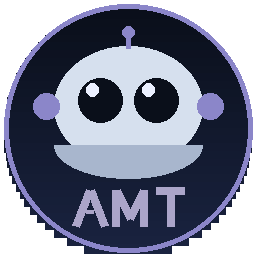

# AMT Chat



> **English:** [README_EN.md](README_EN.md) · **History:** [docs/CHANGELOG.md](docs/CHANGELOG.md) · **Architecture:** [docs/ARCHITECTURE.md](docs/ARCHITECTURE.md) · **Contributing:** [docs/CONTRIBUTING.md](docs/CONTRIBUTING.md)

**Local AI assistant** — чат с любой OpenAI-совместимой или локальной моделью, генерация медиа и файлов, система агентов/скиллов/личностей, оркестратор качества, лонг-терм память, безопасные инструменты, встроенный медиа-плеер и расширяемая система плагинов.

Работает **полностью локально**: бэкенд — FastAPI (Python), фронтенд — vanilla JS (без фреймворков), оболочка — Electron. API-ключ и все данные хранятся **только на вашей машине**.

---

## Возможности

### Чат и модели

- **Любая модель** — OpenAI-совместимая API (OpenAI, Anthropic, Gemini, локальные через Ollama/LM Studio) или локальная. Base URL + ключ + модель. Мульти-ключи с авто-переключением при 429 (по приоритету или round-robin).
- **Markdown-ответы** — с рендером в чате.
- **Вставка картинок/скриншотов/файлов** — Ctrl+V, содержимое попадает в контекст ИИ.
- **Голосовой чат** — STT + TTS через любой провайдер (Vosk локально или облачный).

### Голосовое управление

- **Полный цикл по голосу:** wake-word («Астра» или любая фраза) → запись с VAD-автоостановкой по тишине → STT → LLM → TTS + чат.
- **Wake-word** — локальный Vosk по WebSocket (бэкенд, офлайн, без API-ключа).
- **STT** — локальный Vosk (авто-загрузка модели ~50 МБ при первом запуске) или облачный.
- **TTS** — браузерный `speechSynthesis` (бесплатно) или облачный.
- **Эхо-защита:** микрофон автоматически глушится во время речи ИИ.
- **Статусы:** выкл / слушание / запись / обработка / ответ / речь.

### Агенты, скиллы, личности

- **Агенты** — роль + системный промпт + модель/температура + набор скиллов. Ядро (Веб-агент, Глубокий аналитик, Без фильтров) создаётся автоматически; свои — через UI или импортом `agents.json`/JSONL.
- **Скиллы** — переиспользуемые инструкции, подключаются к агенту или в чате отдельно.
- **Личности** — готовый профиль (API-ключ + модель + агенты + скиллы + оркестратор), создаётся в UI или импортом JSONL.

### Оркестратор качества

- **Контроль контекста** — сжатие истории при переполнении окна модели.
- **Контроль дрейфа роли** — отслеживание отклонения модели от заданной роли.
- **Умное сохранение** — авто-сохранение чата по порогу сообщений.
- **Мониторинг** — задержка/ошибки/среднее по 100 запросам.

### Память

- **Л��нг-терм факты** между чатами, автоматически подставляются в системный промпт.
- **Лимит и очистка** в «Настройки → Память».

### Медиа-генерация

- **`[[GEN:image|…]]`** — генерация картинок (работает с ЛЮБЫМ провайдером через OpenAI-совместимые эндпоинты).
- **`[[GEN:video|…]]`** — генерация видео (таймаут 5 минут, ретраи при сетевой ошибке).
- **`[[GEN:audio|…]]`** — генерация аудио.
- **`[[GEN:file|…]]`** — генерация файлов (xlsx/docx/pptx). ИИ видит данные, а не «бинарный файл».
- **Автодетект Agnes** по `base_url` — включаются Agnes-специфичные параметры.

### Безопасные инструменты (tool-calling)

- **Чтение/запись файлов, создание папок, листинг каталогов, запуск команд** — только в выбранной «рабочей папке» (проект).
- **Запись/команды требуют подтверждения** (auto-approve выключено по умолчанию).
- **Команды — только из белого списка.**
- **Всё логируется.**

### Нативный tool-calling

- При включённом `toolCalling` (вкл. по умолчанию) модель получает JSON-схемы инструментов и сама выпускает `tool_calls`; бэкенд исполняет их через `ToolRegistry` и возвращает результат модели (до 5 итераций).
- **Встроенные инструменты:** генерация картинок/видео/голоса/файлов (`generate_image`, `generate_video`, `generate_audio`, `generate_file`).
- **`[[GEN]]`-токены** — страховка, если провайдер не поддерживает tool-calling.

### MCP-серверы

- **Подключение внешних MCP-серверов** (STDIO-процессы или HTTP-эндпоинты).
- Их инструменты (`mcp__<server>__<tool>`) автоматически появляются в доступных инструментах модели.
- **Переменные окружения сервера шифруются Fernet** (`mcp_key.key`).
- **Инструменты MCP по умолчанию требуют подтверждения** (`auto_approve=False`).
- **Управление:** «Настройки → MCP-серверы» + «Хранилище».
- **Встроенные пресеты:**
  - **RAG** — база знаний (индексация папок, семантический поиск BM25, без тяжёлых зависимостей)
  - **media** — медиа-генерация
  - **writer** — генерация файлов
  - **coding** — read-only диагностика проекта

### Slash-команды

- **15 команд** (`/rag`, `/agent`, `/jailbreak`, `/gen`, `/nav_*`, `/help` и др.) — overlay на один запрос, комбинируются через `+`, контекст выбрасывается после выполнения.
- Реестр в `backend/command_registry.json`, парсер в `command_engine.py`.

### Структурированные логи

- **JSONL в `backend/logs/`** с trace_id-корреляцией.
- **Дашборд «Структура»:** 4 виджета + таблица с фильтрами и автообновлением.

### Хоткеи

- **12 доступных** (навигация, toggle агентов, быстрая генерация), настраиваются в «Настройки → Хоткеи».

### Медиа-плеер

- **YouTube/Twitch embeds**, прямые `.mp4`/`.m3u8`, фото, аудио — воспроизводятся в чате/плеере.
- **Fullscreen**, фильтры (яркость/контраст/детализация/шум/улучшение).
- **Сайты, блокирующие iframe** (X-Frame-Options) — открываются во встроенном frameless-браузере.
- **`[[SCREENSHOT:url]]`** — реальный скриншот страницы через Electron `capturePage`, не og:image.

### Расширения

- **Папки в `extensions/`** с `manifest.json` (+ опц. `index.js`, `backend.py`) — без перекомпиляции приложения.
- Управление: «Справка → Расширения» (вкл/выкл/добавить/обновить список).

### Хранилище

- **Просмотр и экспорт** всех данных (агенты/скиллы/ключи/темы/расширения/чат).

### Темы

- **30 готовых тем + редактор** (градиент, шрифт, фон, язык интерфейса RU/EN).
- **Редактор тем** с предпросмотром по группам (цвета, поверхности, поля и контролы).

### Логи

- **Дашборд событий** по API/оркестратору/инструментам с фильтрами.

### Desktop

- **Electron + встроенный Python-бэкенд** (sidecar, PyInstaller).
- **NSIS-инсталлятор** для Windows.

---

## Быстрая установка (без сборки)

Один файл — и всё готово. Скачайте `AMT Chat Setup 1.1.3.exe` из [GitHub Releases](https://github.com/clashssd/AMT/releases) и запустите инсталлятор. Не нужно устанавливать Python, Node.js или другие зависимости — всё уже включено.

После установки: **Настройки → Подключение** — введите API-ключ, начните чат.

> **Windows SmartScreen** покажет предупреждение «не удалось проверить издателя» — это нормально: AMT Chat не подписан платным кодинг-сертификатом. Нажмите «Подробнее» → «Выполнить в любом случае». Либо запустите портативную копию `AMT Chat 1.1.3 portable (win-unpacked).exe` — она не проходит через NSIS и SmartScreen её не блокирует.

---

## Сборка из исходников

### Один шаг (рекомендуется)

```powershell
git clone https://github.com/clashssd/AMT.git
cd AMT
powershell -ExecutionPolicy Bypass -File scripts\bootstrap_and_build.ps1
```

Скрипт `bootstrap_and_build.ps1` сам, без вашего участия:

1. Проверит, установлены ли **Python 3.12+** и **Node.js**; чего нет — установит автоматически через `winget`.
2. Создаст локальное окружение `backend/.venv` и поставит Python-зависимости.
3. Поставит Node-зависимости.
4. Соберёт готовый `AMT Chat.exe` (портативный) и `AMT Chat Setup <версия>.exe` (NSIS-установщик).
5. Применит патч иконки в готовом `.exe` (обход известного бага electron-builder 25.1.8).

Результат (через ~5–10 минут):

- `release\win-unpacked\AMT Chat.exe` — портативная копия, можно запускать сразу.
- `release\AMT Chat Setup <версия>.exe` — классический инсталлятор.

### Ручная сборка (для разработчика / CI)

```bash
python setup.py        # создаст backend/.venv + поставит зависимости
node setup.js          # npm install
npm run build:all      # PyInstaller -> dist/, затем electron-builder -> release/
node scripts/patch_exe_icon.js   # обход бага с иконкой
```

Подробнее — `docs/BUILD.md`, `docs/SETUP.md`.

---

## Быстрый старт (dev, в браузере)

Бэкенд сам раздаёт фронтенд через `StaticFiles`:

```bash
python -m venv backend/.venv
backend\.venv\Scripts\pip install -r requirements.txt pyinstaller
cd backend && ..\.venv\Scripts\uvicorn main:app --port 8000
```

Откройте `http://127.0.0.1:8000`. Включите API-ключ в «Настройки → Подключение».

> **Тесты бэкенда:** `backend\.venv\Scripts\python.exe -m pytest tests/`

## Desktop (Electron)

```bash
npm install            # установит electron + electron-builder
npm start              # запустит Electron: поднимет Python-бэкенд, откроет окно
```

Electron находит `backend/.venv/Scripts/python.exe` (или используйте `AMT_PYTHON`). Бэкенд стартует на `127.0.0.1:8000`, фронтенд грузится с этого URL.

Окно — frameless: собственный тайтлбар нарисован в HTML и следует активной теме приложения; нативная серая полоса Windows-заголов��а не показывается.

---

## Структура проекта

```
main.js               Electron main process (frameless-окно, sidecar, IPC)
electron/             sidecar.js, ipc.js, preload.js, secrets.js
backend/              FastAPI-бэкенд
  main.py             точки входа API + StaticFiles-раздача фронтенда;
                      entrypoint с AMT_BACKEND_MODE (rag|media|writer|coding)
  stt_local.py        локальный Vosk-STT: wake-word, batch-распознавание
  ai_engine/          agents.py, orchestrator.py, memory.py, media.py,
                      tools.py, web_scraper.py, keymanager.py,
                      extensions.py, filegen.py, sysinteraction.py,
                      tool_registry.py, mcp_manager.py, desktop_tools.py,
                      browser_cdp.py, coding_tools.py, async_utils.py
  command_engine.py   парсинг и выполнение slash-команд
  logging_structured.py  JSONL-логи с trace_id
  coding_mcp_server.py   кодинг-MCP (read-only диагностика проекта)
  rag_server/         локальная база знаний (индекс + BM25-поиск)
  media_server/       медиа-генерация как MCP-сервер
  writer_server/      генерация файлов как MCP-сервер
  agents.json         seed-ядро агентов/скиллов (создаётся при старте)
  keys.json           ваши API-ключи (пустой шаблон, не коммитится)
  settings.json       конфиг оркестратора
  mcp_servers.json    внешние MCP-серверы
frontend/             HTML/JS/CSS (vanilla, без фреймворков)
  home.html           основной UI (SPA)
  js/                 main.js и вспомогательные модули
                      voice.js (голос: state machine, wake-word, VAD, STT, TTS)
  css/                style.css, tokens.css, components-v2.css,
                      commands.css, voice.css, motion-v2.css
  assets/             иконки, изображения
  themes.json         30 готовых тем
extensions/           папки расширений (пример: extensions/example)
docs/                 CHANGELOG.md, ARCHITECTURE.md, BUILD.md,
                      EXTENSIONS.md, SECURITY.md, SETUP.md, CONTRIBUTING.md,
                      COMMANDS_SYSTEM_DETAILED.md
tests/                pytest (бэкенд) + node (фронтенд-модули)
scripts/              build.js, bootstrap_and_build.ps1, patch-скрипты
```

Полное описание — `docs/ARCHITECTURE.md`.

---

## Расширения

Создайте папку `extensions/имя/` с `manifest.json`, опционально `backend.py` (Python, `init(ctx)`) и `index.js` (frontend, `init(ctx)` + `ctx.ui.registerPage`). Перезапустите приложение или нажмите «Обновить список».

См. `docs/EXTENSIONS.md` и в приложении: «Справка → Как писать» (полный гайд с шаблонами).

---

## Агенты, скиллы, личности

Полный гайд — в приложении: «Справка → Как писать» и «Настройки → Docs — примеры и справочник» (копируемые примеры).

- **Агент** = роль + системный промпт + (опц.) модель/температура/скиллы. Создаётся в UI («Настройки → Агенты/Скиллы») или импортом `{"agents":[…]}` / JSONL.
- **Скилл** = готовая инструкция. То же самое — `{"skills":[…]}`.
- **Личность** = профиль (ключ + модель + агенты + скиллы + оркестратор). Создаётся в UI («Настройки → Личность») или импортом JSONL.

## Slash-команды

См. `docs/COMMANDS_SYSTEM_DETAILED.md`. 15 команд, парсер в `command_engine.py`, реестр в `command_registry.json`. Комбинируются через `+`, контекст выбрасывается после выполнения.

## Безопасность

См. `docs/SECURITY.md`. ИИ не выполняет ничего без разрешения: запись/команды требуют подтверждения, команды — только из белого списка, файлы — только в разрешённых каталогах (проект). Каждое действие логируется. API-ключи хранятся локально (шифрованный `SecureStore` на фронтенде, `secrets.bin` на Electron); `backend/keys.json` — пустой шаблон и не коммитится. Env-переменные MCP-серверов шифруются Fernet (`mcp_key.key`).

---

## Тесты

```bash
npm test               # pytest + node (всё)
# или по частям:
backend\.venv\Scripts\python.exe -m pytest tests/
node tests/run_js_tests.js
```

---

## Лицензия

См. файл `LICENSE` (MIT). Расширения, ключи и данные, которые вы добавляете сами, лицензируются вами.

---

## Документация

- **[docs/CHANGELOG.md](docs/CHANGELOG.md)** — история версий от 1.0.0 до 1.1.3.
- **[docs/ARCHITECTURE.md](docs/ARCHITECTURE.md)** — компоненты, процессы, дерево каталогов, жизненный цикл.
- **[docs/CONTRIBUTING.md](docs/CONTRIBUTING.md)** — как собрать, протестировать, внести изменения.
- **[docs/BUILD.md](docs/BUILD.md)** — подробная сборка (PyInstaller, electron-builder, NSIS).
- **[docs/SETUP.md](docs/SETUP.md)** — установка зависимостей, окружения.
- **[docs/EXTENSIONS.md](docs/EXTENSIONS.md)** — система расширений, `manifest.json`, `init(ctx)`.
- **[docs/SECURITY.md](docs/SECURITY.md)** — модель безопасности: шифрование ключей, белые списки, аудит.
- **[docs/COMMANDS_SYSTEM_DETAILED.md](docs/COMMANDS_SYSTEM_DETAILED.md)** — архитектура slash-команд, реестр, парсер.
- **[docs/BRAND.md](docs/BRAND.md)** — design tokens (5 colors, font, shape, motif).
