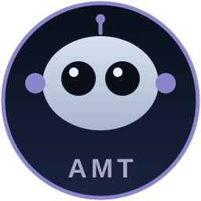

# AMT Chat



> **Русский:** [README.md](README.md) · **History:** [docs/CHANGELOG.md](docs/CHANGELOG.md) · **Architecture:** [docs/ARCHITECTURE.md](docs/ARCHITECTURE.md) · **Contributing:** [docs/CONTRIBUTING.md](docs/CONTRIBUTING.md)

A local (desktop) AI assistant: chat with any OpenAI-compatible or local
model, media and file generation, an agents/skills/personas system, a
quality orchestrator, long-term memory, safe tools (files/commands), a
built-in media player, and an extensible plugin system.

Runs entirely locally: FastAPI (Python) backend, vanilla JS frontend (no
frameworks), Electron shell. Your API key and all data stay on your machine.

Current version — **1.1.3**.

---

## Philosophy

- **Your data stays yours.** AMT does not collect, store or send your chats,
  API keys, or generated files anywhere. Everything lives locally on your
  machine. Closing the app equals closing access to your data.
- **Open source, forever.** Code, docs, and all build tooling are published
  under the MIT license. Forks, modifications, and reinterpretations are
  welcome — the project is open to any developer.
- **Easy to read and understand.** No frameworks, no layers of abstraction,
  no magical dependencies. Frontend is vanilla JS, backend is FastAPI in
  plain Python. Anyone who can follow the code at a "I understand what's
  happening here" level can safely modify the project for their own use.
- **Extend any part.** Extensions (folders in `extensions/`), agents,
  skills, personas, media providers, tools — everything extends without
  recompilation. Drop in your own `backend.py` / `index.js` and it plugs
  into the app.
- **Safe storage by default.** Writes/commands require confirmation,
  commands only from a whitelist, files only inside the project working
  folder. API keys are encrypted in the local `SecureStore`. Everything the
  app does is logged — and visible in "Help → Logs".

## About the project

AMT is a desktop chat client that **you** control. There is no cloud, no
account, no telemetry: only your API key (or a local model) and your local
files. This is not "another AI chat" — it is a construction kit in which
you assemble agents, skills, and extensions for your own tasks and keep
them in your own repository.

---

## Features

- **Chat** — any OpenAI-compatible API or local model (Base URL + key +
  model). Multi-key with auto-failover on 429 (by priority or round-robin).
  Markdown responses. Paste images/screenshots/files (Ctrl+V) — content
  goes into the AI context. Voice chat: STT + TTS via any provider.
- **Voice control** — full voice loop: wake-word ("Астра" or any phrase) →
  VAD recording with auto-stop on silence → STT → LLM → TTS + chat. The
  wake-word is detected by a local Vosk over WebSocket (backend, offline,
  no API key); STT is local Vosk or any OpenAI-compatible cloud; TTS is
  browser `speechSynthesis` (free) or cloud. The mic is auto-muted while
  the AI speaks (echo protection). A mic button sits in the composer menu
  (states: off / listening / recording / processing / responding /
  speaking). Settings: "Settings → Voice" (wake-word, silence timer,
  sensitivity) and "Settings → Providers" (STT/TTS, keys, URL). All
  API keys are stored encrypted in `secrets.bin` (Electron
  safeStorage/DPAPI), never in `settings.json`.
- **Agents** — role + system prompt + model/temperature + skill set.
  Core agents (Web-agent, Deep analyst, No filters) are created
  automatically; your own agents — via UI or import from
  `agents.json`/JSONL.
- **Skills** — reusable instructions, attached to an agent or separately
  in chat.
- **Personas** — a ready profile (API key + model + agents + skills +
  orchestrator), created in UI or imported from JSONL (one session per
  line).
- **Orchestrator** — context control (history compression when the model
  window overflows), role-drift control, smart chat-saving by threshold,
  monitoring (latency/errors/average over 100 requests). Configured in
  "Settings → Orchestrator".
- **Memory** — long-term facts across chats, automatically injected into
  the system prompt; limit and clearing in "Settings → Memory".
- **Media generation** — `[[GEN:image|…]]`, `[[GEN:video|…]]`,
  `[[GEN:audio|…]]`, `[[GEN:file|…]]` — the AI inserts a ready element
  (image/video/audio/file) directly into the message; works with ANY
  provider via OpenAI-compatible endpoints, not just OpenAI. Agnes
  auto-detect by `base_url` (`https://apihub.agnes-ai.com/v1`) —
  Agnes-specific parameters are enabled (`return_base64: true` for
  images, `seconds: "5"` for video). Files (xlsx/docx/pptx): the backend
  opens the real file, the AI sees the data, not "binary file".
- **Safe tools (tool-calling)** — read/write files, create folders,
  list directories, run commands — only in the chosen "working folder"
  (project). Writes/commands require confirmation (auto-approve is off by
  default), commands only from a whitelist. Everything is logged.
- **Native tool-calling** — with `toolCalling` enabled (on by default)
  the model receives JSON tool schemas and emits `tool_calls` itself; the
  backend executes them via `ToolRegistry` and returns the result to the
  model (up to 5 iterations). Built-in tools: image/video/audio/file
  generation (`generate_image`, `generate_video`, `generate_audio`,
  `generate_file`). `[[GEN]]` tokens are kept as a fallback in case the
  provider does not support tool-calling.
- **MCP servers** — connect external MCP servers (STDIO processes or HTTP
  endpoints). Their tools (prefix `mcp__<server>__<tool>`) automatically
  appear in the model's available tools. Server environment variables are
  encrypted with Fernet (`mcp_key.key`); MCP tools require confirmation
  by default (`auto_approve=False`). Management: "Settings → MCP servers"
  + "Storage". Built-in presets: RAG (knowledge base), media
  (media generation), writer (file generation), coding (read-only project
  diagnostics).
- **Slash commands** — 15 commands (`/rag`, `/agent`, `/jailbreak`, `/gen`,
  `/nav_*`, `/help`, etc.) — overlay on one request, combined with `+`,
  context discarded after execution. Registry in
  `backend/command_registry.json`, parser in `command_engine.py`.
- **Structured logs** — JSONL in `backend/logs/`, trace_id correlation.
  "Structure" dashboard: 4 widgets + table with filters and
  auto-refresh.
- **Hotkeys** — 12 available (navigation, agent toggles, quick
  generation), configured in "Settings → Hotkeys".
- **Media player** — YouTube/Twitch embeds, direct `.mp4`/`.m3u8`,
  photos, audio — played in chat/player, fullscreen, filters
  (brightness/contrast/detail/noise/enhancement). Sites that block iframes
  (X-Frame-Options) open in a built-in frameless browser.
  `[[SCREENSHOT:url]]` — a real page screenshot via Electron `capturePage`,
  not og:image.
- **Extensions** — folders in `extensions/` with `manifest.json` (+
  optional `index.js`, `backend.py`) — no app recompile. Management:
  "Help → Extensions" (on/off/add/refresh list).
- **Storage** — view and export all data (agents/skills/keys/themes/
  extensions/chats).
- **Logs** — event dashboard for API/orchestrator/tools with filters.
- **Themes** — ready + custom (gradient), font and background, UI language
  (RU/EN). Theme editor with live preview by group (colors, surfaces,
  fields and controls).
- **Auto-updates** — on startup and once a day; manual check —
  "Help → Updates". Cross-platform: Windows (NSIS), Linux/macOS — link to
  GitHub Releases.
- **Desktop** — Electron + embedded Python backend (sidecar, PyInstaller),
  NSIS installer for Windows.

---

## Quick install (no build)

One file — and you're done. Run `AMT Chat Setup 1.1.3.exe` from the
`release/` folder (or unpack `AMT Chat 1.1.3 release.zip`) and follow the
installer wizard. No need to install Python, Node.js, or any other
dependencies — everything is bundled in the installer.

```
release/AMT Chat Setup 1.1.3.exe
```

After install: **Settings → Connection** — enter your API key, start
chatting.

> Windows SmartScreen will show a "publisher cannot be verified" warning —
> this is normal: AMT Chat is not signed with a paid code-signing
> certificate (DigiCert/GlobalSign). Click "More info" → "Run anyway". Or
> run the portable copy `release\win-unpacked\AMT Chat.exe` — it does not
> go through NSIS and SmartScreen will not block it.

---

## Build from source

### One step (recommended)

```powershell
git clone https://github.com/clashssd/AMT.git
cd AMT
powershell -ExecutionPolicy Bypass -File scripts\bootstrap_and_build.ps1
```

The `bootstrap_and_build.ps1` script will, with no input from you:

1. Check that **Python 3.12+** and **Node.js** are installed; whatever is
   missing is installed automatically via `winget` (the standard Windows
   10/11 package manager; on very old/minimalist setups without winget —
   install them manually, see `docs/SETUP.md`).
2. Create the `backend/.venv` environment and install Python deps.
3. Install Node deps.
4. Build the ready `AMT Chat.exe` (portable) and
   `AMT Chat Setup <version>.exe` (NSIS installer) — this installer can
   be run as a regular Windows application.
5. Apply the icon patch to the ready `.exe` (workaround for a known
   electron-builder 25.1.8 bug that silently skips the custom icon on
   this stack).

Result (in ~5–10 minutes):

- `release\win-unpacked\AMT Chat.exe` — portable copy, can be run
  immediately without install.
- `release\AMT Chat Setup <version>.exe` — classic installer; run it and
  the app installs as a regular Windows app (desktop shortcut, "Uninstall"
  in "Settings → Apps").

> Why not "just download the ready .exe from a release": the ready
> installer is ~270 MB — this exceeds GitHub's hard limit for a single
> file in a regular `git push` (~100 MB), so the `.exe` is **not
> committed** to the repository (see `.gitignore`). If you have a ready
> `AMT Chat Setup.exe` from the developer (e.g. passed as a file), you can
> just run it — it is the same application built by the same pipeline.

### Manual build (for developer / CI)

```bash
python setup.py        # create backend/.venv + install deps
node setup.js          # npm install
npm run build:all      # PyInstaller -> dist/, then electron-builder -> release/
node scripts/patch_exe_icon.js   # icon workaround (see above)
```

Details — `docs/BUILD.md`, `docs/SETUP.md`.

---

## Quick start (dev, in a browser)

The backend serves the frontend via `StaticFiles`, so it's enough to:

```bash
# Python 3.12+ and Node.js installed
python -m venv backend/.venv
backend\.venv\Scripts\pip install -r requirements.txt pyinstaller
cd backend && ..\.venv\Scripts\uvicorn main:app --port 8000
```

Open `http://127.0.0.1:8000`. Enable your API key in "Settings →
Connection".

> Backend tests: `backend\.venv\Scripts\python.exe -m pytest tests/`.

## Desktop (Electron)

```bash
npm install            # install electron + electron-builder
npm start              # start Electron: boot the Python backend, open the window
```

Electron finds `backend/.venv/Scripts/python.exe` (or use `AMT_PYTHON`).
The backend starts on `127.0.0.1:8000`, the frontend loads from this URL —
all `fetch` calls work unchanged.

The window is frameless: a custom titlebar (drag, min/max/close buttons)
is drawn in HTML and follows the active app theme; the native grey
Windows titlebar is not shown.

## Build (distributable)

See `docs/BUILD.md` and `docs/SETUP.md`. Short version:

```bash
npm run build:py       # PyInstaller: backend -> dist/amt-backend/ (sidecar bundle)
npm run build:win      # electron-builder: NSIS installer -> release/
# or all at once:
npm run build:all      # node scripts/build.js all
```

Result: `release/AMT Chat Setup <version>.exe` (version from
`package.json`). electron-builder copies `dist/amt-backend/` into the
bundle's `extraResources`, uses `frontend/assets/favicon.ico` (generated
from `frontend/assets/icon.svg`) as the exe/installer icon.

---

## Project structure

Full description of components, processes, and the directory tree — in
`docs/ARCHITECTURE.md`. Short version:

```
main.js               Electron main process (frameless-window, sidecar, IPC)
electron/             sidecar.js, ipc.js, preload.js, secrets.js
backend/              FastAPI backend
  main.py             API entry points + StaticFiles-frontend-serving;
                      entrypoint with AMT_BACKEND_MODE (rag|media|writer|coding)
  stt_local.py        local Vosk-STT: wake-word, batch recognition,
                      auto model-load
  ai_engine/          agents.py, orchestrator.py, memory.py, media.py,
                      tools.py, web_scraper.py, keymanager.py,
                      extensions.py, filegen.py, sysinteraction.py,
                      tool_registry.py, mcp_manager.py, desktop_tools.py,
                      browser_cdp.py, coding_tools.py, async_utils.py
  command_engine.py   slash-command parser and execution
  logging_structured.py  JSONL logs with trace_id
  coding_mcp_server.py   coding-MCP (read-only project diagnostics)
  rag_server/         local knowledge base (index + BM25 search)
  media_server/       media generation as an MCP server
  writer_server/      file generation as an MCP server
  agents.json         agent/skill seed-core (created at startup)
  keys.json           your API keys (empty template, not committed)
  settings.json       orchestrator config
  mcp_servers.json    external MCP servers (created on add)
  changelog.json      version history (shown in "Help → Updates")
frontend/             HTML/JS/CSS (vanilla, no frameworks)
  home.html           main UI (SPA)
  js/                 main.js and helper modules
                      voice.js (voice: state machine, wake-word, VAD, STT, TTS)
  css/                style.css, tokens.css, components-v2.css,
                      commands.css, voice.css, motion-v2.css
  assets/             icons, images
  themes.json         ready themes
extensions/           extension folders (example: extensions/example)
docs/                 CHANGELOG.md, ARCHITECTURE.md, BUILD.md,
                      EXTENSIONS.md, SECURITY.md, SETUP.md, CONTRIBUTING.md,
                      COMMANDS_SYSTEM_DETAILED.md
tests/                pytest (backend) + node (frontend modules)
scripts/              build.js, bootstrap_and_build.ps1, patch scripts
```

---

## Extensions

See `docs/EXTENSIONS.md` and in the app itself: "Help → How to write"
(full guide with templates) and "Help → Extensions" (management hub).
Short version: create a folder `extensions/name/` with `manifest.json`,
optionally `backend.py` (Python, `init(ctx)`) and `index.js` (frontend,
`init(ctx)` + `ctx.ui.registerPage`). Restart the app or click "Refresh
list".

## Agents, skills, orchestrator, personas

Full guide with templates and install methods (UI / JSON/JSONL import) —
in the app: "Help → How to write" and "Settings → Docs — examples and
reference" (copyable examples). Short version:

- Agent = role + system prompt + (opt.) model/temperature/skills. Created
  in UI ("Settings → Agents/Skills") or imported via `{"agents":[…]}` /
  JSONL.
- Skill = a ready instruction. Same — `{"skills":[…]}`.
- Persona = a profile (key + model + agents + skills + orchestrator).
  Created in UI ("Settings → Persona") or imported from JSONL (one line).
- Orchestrator — configured in UI ("Settings → Orchestrator"), not an
  importable "file" — parameters (`enabled`, `auto_mode`,
  `role_drift_check`, `monitor_latency`, `auto_save_threshold`,
  `keep_full_context`).

## Slash commands

See `docs/COMMANDS_SYSTEM_DETAILED.md`. 15 commands, parser in
`command_engine.py`, registry in `command_registry.json`. Combined with
`+`, context discarded after execution.

## Security

See `docs/SECURITY.md`. The AI does nothing without permission:
writes/commands require confirmation, commands only from a whitelist,
files only in allowed directories (project). Every action is logged. API
keys are stored locally (encrypted `SecureStore` on the frontend,
`secrets.bin` on Electron); `backend/keys.json` is an empty template and
not committed. MCP server environment variables are encrypted with Fernet
(`mcp_key.key`).

## Tests

```bash
npm test               # pytest + node (all)
# or by part:
backend\.venv\Scripts\python.exe -m pytest tests/
node tests/run_js_tests.js
```

## License

See the `LICENSE` file (MIT). Extensions, keys, and data that you add
yourself are licensed by you.

---

## Documentation

- **[docs/CHANGELOG.md](docs/CHANGELOG.md)** — version history from 1.0.0
  to 1.1.3 (brief, readable) and pre-1.0.0 versions.
- **[docs/ARCHITECTURE.md](docs/ARCHITECTURE.md)** — components,
  processes, directory tree, lifecycle, key decisions, where user data
  lives.
- **[docs/CONTRIBUTING.md](docs/CONTRIBUTING.md)** — how to build, test,
  contribute, versioning, what not to do.
- **[docs/BUILD.md](docs/BUILD.md)** — detailed build (PyInstaller,
  electron-builder, NSIS, signing, SmartScreen).
- **[docs/SETUP.md](docs/SETUP.md)** — installing dependencies,
  environments, winget decisions.
- **[docs/EXTENSIONS.md](docs/EXTENSIONS.md)** — the extension system,
  `manifest.json`, `init(ctx)`, `ctx.ui.registerPage`, `ctx.backend.call`.
- **[docs/SECURITY.md](docs/SECURITY.md)** — the security model: key
  encryption, whitelists, audit, what is logged.
- **[docs/COMMANDS_SYSTEM_DETAILED.md](docs/COMMANDS_SYSTEM_DETAILED.md)** —
  slash-command architecture, registry, parser, request flow.
